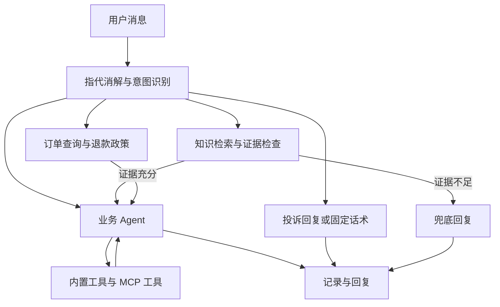

# ShopPilot

[](https://www.python.org/)
[](https://fastapi.tiangolo.com/)
[](https://github.com/langchain-ai/langgraph)
[](https://milvus.io/)
[](https://modelcontextprotocol.io/)
[](LICENSE)

**ShopPilot 是一个面向电商场景的工业级智能客服与售后 Agent 系统。**

ShopPilot 基于 Python 3.12、FastAPI 与 LangGraph 构建，将多轮对话意图分流、业务工具调用、高精度混合检索 RAG 与人机协同（Human-in-the-Loop）组合为端到端客服工作流：实现用户问题理解、订单与物流查询、退款售后流转、人工确认拦截，并记录会话链路与 Token 成本。演示环境预置模拟订单与物流数据，可快速完成功能验证与定制开发。

## 核心能力

| 模块 | 功能 |
| --- | --- |
| 对话与 Agent | 流式聊天、结构化提取、LangGraph 工作流与 ReAct 工具循环 |
| 意图分流 | 指代消解、业务查询、知识问答、退款流程与投诉回复 |
| RAG | 文档切块、向量与 BM25 混合检索、RRF 融合、重排与 Query 改写 |
| 回答约束 | 生成前证据置信度检查、低置信度兜底与回答自检 |
| 售后流程 | 查询订单、检索政策、人工确认及 interrupt/resume 恢复 |
| 工具系统 | 内置业务工具、MCP 动态发现、超时、只读重试与审计记录 |
| 上下文管理 | 对话滑窗、异步摘要、稳定提示前缀与会话持久化 |
| 知识运营 | MySQL / Milvus 双写、对话挖掘、查重、人工复核与知识补库 |
| 可观测性 | 可选 Langfuse 跟踪、按意图统计 Token 成本与评估趋势 |
| 主题分类 | 17 类主题语料流水线、分类器微调、阈值扫描与 ONNX 推理 |
| 管理界面 | 知识库录入、RAG 评估、待审队列、成本看板与分类器验收 |

## 快速开始

### 环境要求

- Python 3.12 或以上、uv、Git。
- Docker 与 Docker Compose，用于 MySQL、Milvus、etcd 和 MinIO。
- 可访问的聊天、嵌入和重排服务，以及对应 API key。
- 使用 make 命令时需 GNU Make 与 Bash；Windows 可在配置好工具的 Git Bash 或 WSL 中运行。

### 1. 获取项目并安装依赖

```bash
git clone https://github.com/Phantomor/ShopPilot.git
cd ShopPilot
uv sync --locked
cp .env.example .env
```

PowerShell 中用 `Copy-Item .env.example .env` 复制配置文件。中文 Windows 在运行 Python 前设置 `$env:PYTHONUTF8 = "1"`；Makefile 和开发启动脚本已设置该变量。

### 2. 配置模型

编辑 `.env`，填入服务实际支持的地址、模型与密钥。聊天、嵌入、重排分别直连各自上游：

| 配置 | 用途 |
| --- | --- |
| `CHAT_BASE_URL`、`CHAT_MODEL`、`CHAT_API_KEY` | 聊天与 Agent 模型，均为必填 |
| `EMBED_API_KEY` | 嵌入服务密钥，必填 |
| `EMBED_BASE_URL`、`EMBED_MODEL` | 嵌入服务地址与模型，可覆盖默认值 |
| `RERANK_API_KEY` | 重排服务密钥，必填 |
| `RERANK_BASE_URL`、`RERANK_MODEL` | 重排服务地址与模型，可覆盖默认值 |
| `DATABASE_URL` | 业务 MySQL 连接，默认本机 mewhelp 数据库 |
| `MILVUS_URI` | Milvus 地址，默认 http://localhost:19530 |

聊天接口需要支持工具调用；重排接口使用 `/rerank` 形状。示例中的模型名需按自己的服务核对，思考模式参数的支持情况也取决于上游。完整字段与默认值见 [配置实现](app/config.py) 和 [环境变量模板](.env.example)。

### 3. 启动基础服务并建立知识库

在 Bash 环境执行：

```bash
docker compose up -d
docker compose ps
# 等待 MySQL 与 Milvus 健康检查通过，再执行：
make kb-build
make kb-vectorize
```

MySQL 首次创建数据卷时会按文件名顺序执行 `sql/` 中的初始化脚本，包含建表和演示数据。已有数据卷不会自动重跑脚本，升级时需检查相应迁移。`kb-vectorize` 会调用嵌入服务。

### 4. 启动应用

```bash
make dev
```

该命令在前台运行，先检查依赖容器并启动两台 MCP Server，再启动 FastAPI。浏览器访问 http://localhost:8000；管理入口为 http://localhost:8000/admin，接口文档为 http://localhost:8000/docs。

原生 PowerShell 也可以在完成依赖安装与 `.env` 配置后，按顺序执行：

```powershell
$env:PYTHONUTF8 = "1"
$env:PYTHONPATH = "."
docker compose up -d
# 等待容器健康检查通过
uv run python -m scripts.build_kb
uv run python -m scripts.vectorize_kb
```

然后在三个独立终端中分别运行以下命令；各终端均需进入项目根目录并设置上述环境变量：

```powershell
uv run python -m mcp_servers.logistics_server
uv run python -m mcp_servers.aftersales_server
uv run uvicorn app.main:app --port 8000
```

更多本地部署步骤见 [DEPLOY.md](DEPLOY.md)。

## 使用方式

在聊天页输入任务，例如：

```text
订单 1001 的物流到哪了？
退货运费由谁承担？
我想申请订单 1001 的退款。
```

订单查询应出现相应工具调用；退款流程涉及写操作时按页面提示确认。订单与物流数据是模拟业务数据，不能用于查询真实订单。

| 页面 | 路径 |
| --- | --- |
| 客服聊天 / 管理首页 | `/` / `/admin` |
| 知识库录入 / RAG 评估 | `/kb` / `/rag-eval` |
| 知识飞轮待审 | `/review` |
| 观测与成本 | `/observability` |
| 主题分布 | `/topics` |
| 分类器验收 | `/acceptance` |

## 工作流与工具扩展



图编排见 [app/graph/build.py](app/graph/build.py)。主力 Agent 默认最多执行 6 步；持久化检查点支持中断后恢复。

工具注册与执行位于 `app/tools/`。两台独立 MCP Server 使用 Streamable HTTP，地址由 `MCP_LOGISTICS_URL` 与 `MCP_AFTERSALES_URL` 配置，默认端口分别为 8101、8102。统一执行引擎负责超时、只读重试及审计；业务示例实现见 `mcp_servers/`。

## 知识运营与主题分类

`data/kb/` 提供演示知识文档，切块后先写入 MySQL，再嵌入到 Milvus。检索支持向量、BM25、混合检索与混合检索加重排四种策略。

知识飞轮从低置信度问题和对话中挖掘候选知识，经标准化、查重与人工复核后补库。`make flywheel` 运行批处理，待审项在 `/review` 处理。

主题分类器是独立的可选流程：

```bash
make ch10-corpus
make ch10-dataset
make ch10-train
make ch10-eval
make ch10-export
make classifier-up
```

语料构建依赖 MySQL 和聊天服务；训练与导出命令按需安装 `ml` 依赖组。仓库不包含训练权重、ONNX 模型或完整训练数据，需先生成相应产物。分类服务默认监听 8110。

可选 Langfuse 使用独立 Compose 项目：`make langfuse-up`，页面端口为 3000。同时配置 `LANGFUSE_PUBLIC_KEY`、`LANGFUSE_SECRET_KEY` 与 `LANGFUSE_BASE_URL` 后启用跟踪；未配置时主应用仍可运行。

## 验证与评估

```bash
make test
make smoke-rag
make eval-rag
make eval-ch06
make eval-ch08
```

测试中的模型调用通常使用替身；数据库测试仍需要 MySQL。测试夹具会重建 `TEST_DATABASE_URL` 指定数据库内的相关表，必须使用独立测试库，默认名为 `mewhelp_ch02_test`。RAG 和端到端评估需要真实基础服务、已建知识库及有效模型配置。

仓库保留的历史报告包括：

| 评估 | 已保存结果 | 解释范围 |
| --- | --- | --- |
| RAG 四策略对照 | 混合检索加重排的总体 Recall@5 为 0.98、MRR 为 0.89 | 历史固定评估集的检索结果，不等于回答准确率 |
| 无答案问题拒答 | D 桶 60/60 正确拒答 | 指定样本与当时模型配置下的结果 |
| 主题分类器 | 161 条留出样本，micro-F1 0.964、macro-F1 0.962 | 指定数据划分与阈值下的历史结果 |

详见 [RAG 报告](data/ch04/reports/rag_eval.txt)、[置信度校准](data/ch09/reports/confidence_calibration.txt) 和 [分类器报告](data/ch10/reports/eval_report.md)。这些文件是随源码保留的已有记录，并非本次发布重新测得；更换模型、语料或环境后应重新评估。完整命令见 [Makefile](Makefile)，可通过 `make help` 查看带说明的目标。

## 项目结构

```text
app/
├── api/           # HTTP 接口、后台任务与管理能力
├── graph/         # 状态、节点、分流与 LangGraph 组装
├── core/          # 模型客户端、检索、意图、摘要与观测
├── kb/            # 文档切块、双写、去重与知识挖掘
├── tools/         # 内置工具、MCP 客户端与执行引擎
├── db/            # SQLAlchemy 模型与仓储
├── schemas/       # 请求与响应模型
└── static/        # 聊天与管理页面
mcp_servers/       # 物流与售后 MCP 服务
scripts/           # 建库、评估、飞轮与分类器脚本
sql/               # 建表、迁移与演示数据
tests/             # 单元与集成测试、固定评估样例
data/kb/           # 演示知识文档
data/ch*/reports/  # 历史评估报告
docs/superpowers/  # 分章节设计与实现计划
```

## 当前边界

- 业务数据和工具面向演示，尚未接入真实电商订单、物流或支付系统。
- Compose 中的默认账号与密码用于本地开发；对外部署前需要补充鉴权、访问控制和生产配置。
- 意图识别的 cost 模式与小模型降级配置当前为预留字段，未接入运行时。
- 模型接口兼容性、依赖安装及端到端行为需在目标环境验证；历史报告不代表跨平台或生产负载验证。
- `.env`、本地检查点、日志、虚拟环境和训练产物不提交到 Git。
## 许可证

本项目基于 [MIT](LICENSE) 协议开源。

